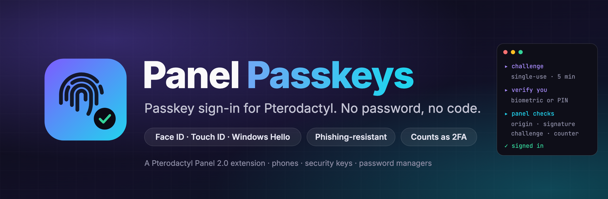
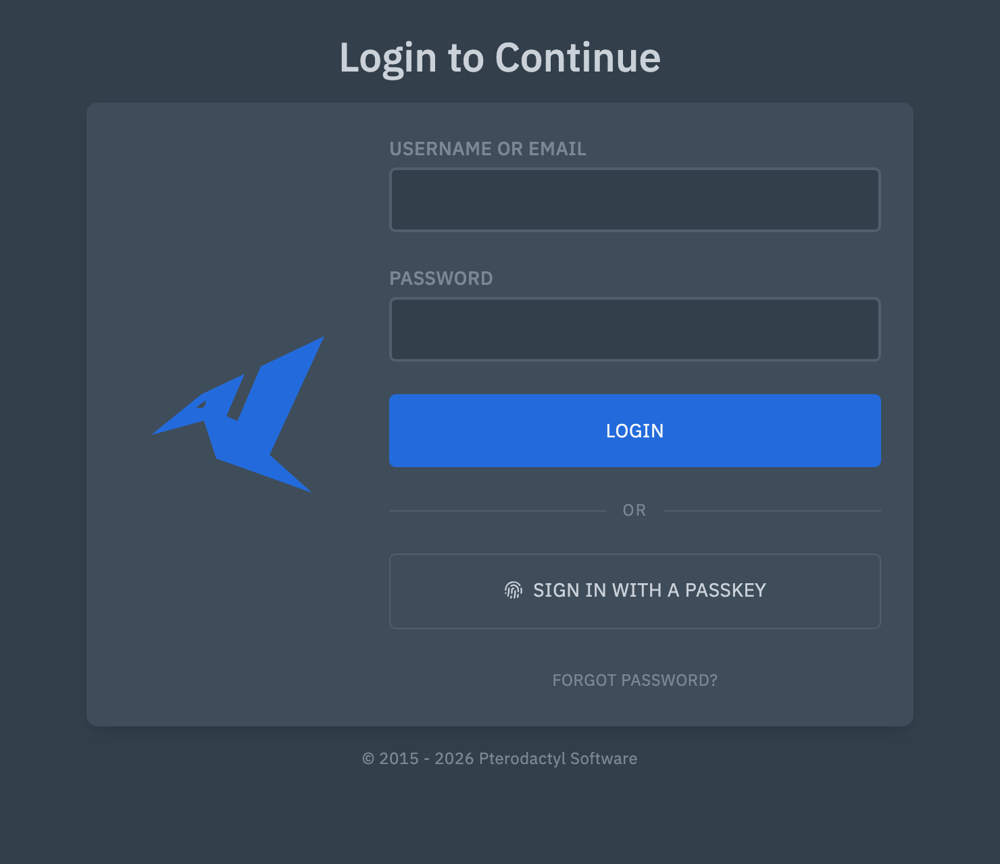
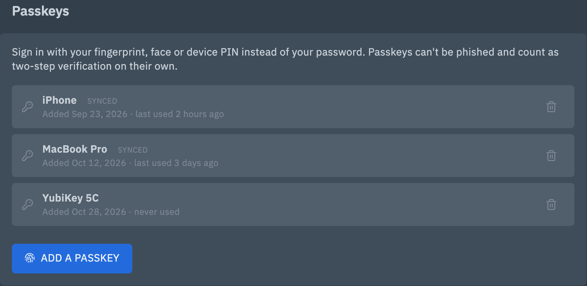
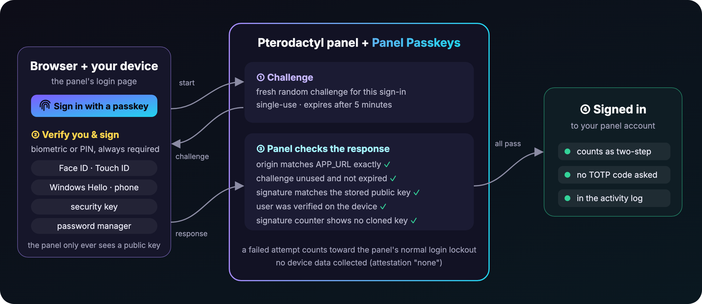
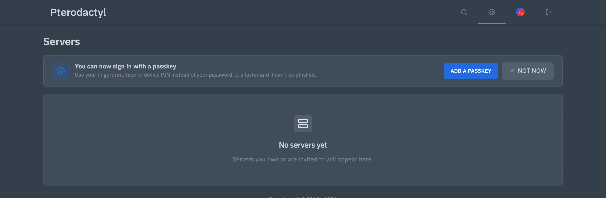

<p align="center">
  
</p>

<p align="center">
  <a href="https://github.com/jackh54/pterodactyl-panel-passkeys/releases/latest"></a>
  
  
  
  <a href="LICENSE"></a>
</p>

<p align="center">
  <b>Panel Passkeys</b> is a Pterodactyl Panel extension that adds <a href="https://passkeys.dev">passkey</a> sign-in.<br>
  Your users sign in with Face ID, Touch ID, Windows Hello, their phone, a security key or their password manager:<br>
  no password to type, nothing to phish, and it counts as two-step verification on its own.
</p>

<p align="center">
  <a href="#-install">Install</a> ·
  <a href="#-for-your-users">For your users</a> ·
  <a href="#-security">Security</a> ·
  <a href="#%EF%B8%8F-settings">Settings</a> ·
  <a href="#-faq">FAQ</a>
</p>

---

## ✨ Why

Passwords get reused, guessed and typed into fake login pages. TOTP codes help, but they can be phished too, and people lose the phone that holds them. Passkeys fix both: the private key never leaves the user's device, and the browser only offers it to **your** panel's real address.

- **One tap to sign in.** A *Sign in with a passkey* button sits under the normal login form. The browser shows the passkeys it holds for the panel; the user picks one and confirms with a fingerprint, face or PIN.
- **Counts as two-step.** User verification is always required, so a passkey sign-in skips the TOTP checkpoint, like the major sites do. Password sign-in keeps working exactly as before.
- **Works with what people already have.** iCloud Keychain, Google Password Manager, Windows Hello, 1Password, Bitwarden, Dashlane, YubiKeys and other FIDO2 keys. Synced passkeys are labelled as such.
- **Nothing to run.** No extra service, port or container: it runs inside the panel. One PHP dependency ([lbuchs/webauthn](https://github.com/lbuchs/WebAuthn), MIT) ships in the package.
- **Built for v2.** Native panel components, light and dark themes, the panel's activity log, its login lockout and its admin settings form.

<p align="center">
  
  &nbsp;
  
</p>

## 🧭 How it works

<p align="center">
  
</p>

1. **Adding a passkey** (Account → Passkeys): the user confirms their password, names the passkey and follows their device's prompt. The panel stores only the public key.
2. **Signing in:** the browser asks the panel for a one-time challenge, the device verifies the user (biometric or PIN) and signs the challenge, and the panel checks the address it was signed for, the challenge, the signature and the authenticator's counter before signing the user in through the panel's normal login path.

## 📦 Install

> [!IMPORTANT]
> Panel Passkeys is an extension for **Pterodactyl Panel v2** (the `2.0-develop` branch and its extension SDK). It does not run on 1.x and is not a Blueprint extension.
>
> Passkeys need the panel on **HTTPS** at the exact address in `APP_URL` (browsers allow `http://localhost` for testing only).

**From a release (recommended).** Download `panel-passkeys.pteroext` from the [latest release](https://github.com/jackh54/pterodactyl-panel-passkeys/releases/latest), then on the panel host:

```bash
cd /var/www/pterodactyl
php artisan p:extension:install /path/to/panel-passkeys.pteroext --enable
```

That runs the extension's migration (two `ext_passkeys_user_*` tables) and publishes its frontend. Reload the panel in your browser: the sign-in page now has the passkey button, and every account page a Passkeys card.

**From source.** Build it against your panel's SDK (from a panel checkout where `npm ci && npm run build` has run):

```bash
git clone https://github.com/jackh54/pterodactyl-panel-passkeys.git && cd pterodactyl-panel-passkeys
mkdir -p .sdk && (cd /path/to/panel/packages/sdk && npm pack --pack-destination "$OLDPWD/.sdk")
mv .sdk/pterodactyl-sdk-*.tgz .sdk/pterodactyl-sdk.tgz
composer install --no-dev --optimize-autoloader
npm install && npm run build && npm test
cd /var/www/pterodactyl
php artisan p:extension:pack /path/to/pterodactyl-panel-passkeys --output=/tmp/panel-passkeys.pteroext
php artisan p:extension:install /tmp/panel-passkeys.pteroext --enable
```

**Updating:** install the new `.pteroext` the same way (add `--replace`). Passkeys are kept.

**Removing:** `php artisan p:extension:disable panel-passkeys` turns it off and keeps everything; `p:extension:remove panel-passkeys` also deletes its files. Either way users sign in with their password again, and their passkeys stay in the database (re-enable to bring them back) until you drop the two `ext_passkeys_user_*` tables.

## 🙋 For your users

- **Add a passkey:** Account → **Passkeys** → *Add a passkey*, confirm the password, name it (the panel guesses "iPhone", "Mac", "Windows PC"...) and follow the device prompt. Add one per device, or one synced passkey from a password manager.
- **Sign in:** *Sign in with a passkey* under the login form. No username needed.
- **Remove one:** the bin icon next to it, then the password. A lost device? Remove its passkey from any signed-in device, or ask an admin.
- A one-time notice on the dashboard tells existing users passkeys are available (dismissible; admins can turn it off).

<p align="center">
  
</p>

## 🔒 Security

Panel Passkeys was written to be safe as a production sign-in method.

| | |
|---|---|
| **Origin** | The relying party is the host in `APP_URL`, and the browser origin must match `APP_URL` exactly (scheme, host and port, constant-time compare) before the WebAuthn library runs its own checks. A passkey made for one panel cannot sign in to a look-alike. |
| **User verification** | Biometric or PIN and user presence are required on every registration and sign-in, so a passkey is a complete second factor. |
| **Challenges** | 32 random bytes, bound to the session, the ceremony and (when adding) the user; valid for 5 minutes; removed before anything is verified, so each works once even when it fails; an atomic cache marker stops two parallel requests from using the same one. The pre-login session is destroyed at sign-in, so a copied cookie can't replay it. |
| **Clones** | Signature counters may only go up (compare-and-swap); a counter that stalls or goes backwards is refused. |
| **Privacy** | The WebAuthn user handle is 32 random bytes, never the user's id, email or username. Attestation is `none`: no device make or model is collected. Only public keys are stored. |
| **Brute force** | Every failure gives the same answer, fires the panel's failed-login event and counts towards the panel's own login lockout (shared with password sign-in), plus its per-address request limit. Adding or removing a passkey needs the account password, 5 tries a minute. |
| **API keys** | Passkeys can only be listed or changed from a signed-in panel session, never with an API key. |
| **Audit** | Sign-ins, additions and removals land in the activity log; the account owner gets an email when a passkey is added or removed. |

Sign-in still ends in the panel's own `CompletesLogins` action, so anything that hooks it (for example an extension that refuses suspended accounts) applies to passkey sign-ins too.

Found a vulnerability? Please read [SECURITY.md](SECURITY.md) and report it privately.

## ⚙️ Settings

**Admin → Extensions → Panel Passkeys:**

| Setting | Default | What it does |
|---|---|---|
| Passkeys per account | `10` | How many passkeys one account may hold (1 to 25). Lowering it keeps existing passkeys. |
| Invite users to add a passkey | on | The one-time dashboard notice for accounts without a passkey. |
| Email on passkey changes | on | Email the account owner when a passkey is added or removed. Needs working panel mail. |

**Command line:**

```bash
php artisan panel-passkeys:clear <user id, username or email>   # list an account's passkeys and remove them
```

**`.env`** (optional, then `php artisan config:clear`):

| Variable | Default | What it does |
|---|---|---|
| `PANEL_PASSKEYS_TABLE_PREFIX` | `ext_passkeys_user_` | Prefix of the two tables (`…passkeys`, `…prefs`). Only change it before installing, or to reuse tables from an earlier install with the same layout. |

## ❓ FAQ

**Can users still sign in with a password?** Yes. Passkeys are an extra option; nothing about password + TOTP sign-in changes.

**What if someone loses their only passkey device?** They sign in with their password (and TOTP if they use it) and add a new one. Synced passkeys (iCloud Keychain, Google, 1Password...) come back with the account on a new device. An admin can also run `panel-passkeys:clear`.

**"Passkeys only work on the official panel address"?** The browser refused because the page isn't on `APP_URL`'s exact host over HTTPS. Fix `APP_URL` or open the panel at that address. Moving the panel to a new domain means users add their passkeys again.

**Does it work behind Cloudflare / a reverse proxy?** Yes, as long as users reach the panel at `APP_URL`. Set `TRUSTED_PROXIES` so the activity log and lockout see real client addresses.

## 🧪 Development

```bash
composer install --no-dev      # the WebAuthn library, shipped in vendor/
npm install && npm run build   # frontend (sign-in button, account card, dashboard notice)
npm test && npx tsc            # unit tests and types
php tests/upstream-classes.php ../panel   # every panel class the extension uses still exists
```

`tests/e2e` holds an end-to-end suite of 85 checks that registers and uses real ES256 passkeys from a software authenticator over HTTP against a **local** dev panel, then tampers with one thing at a time (origin, flags, signature, challenge, user handle, counter, replays, races, lockouts). See [tests/e2e/README.md](tests/e2e/README.md).

## 📄 License

[MIT](LICENSE) © PandaScript. Not affiliated with or endorsed by Pterodactyl Software. "Passkey" is used in its generic FIDO Alliance sense.

<p align="center"><sub>Also from PandaScript: <a href="https://github.com/jackh54/pterodactyl-panel-mcp">Panel MCP</a>, an MCP server inside your Pterodactyl panel.</sub></p>
